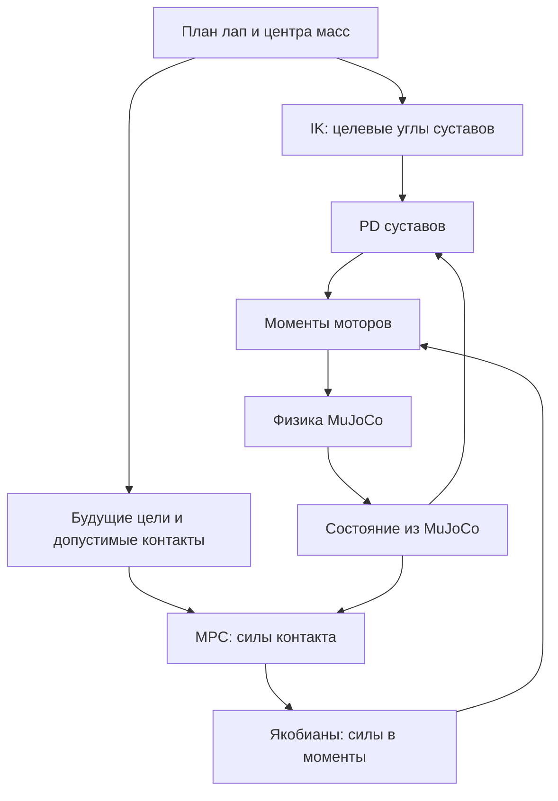

# MPC для робособаки Unitree A1 в MuJoCo

Задача проекта — сначала научиться управлять отдельной робособакой через MPC: удерживать стойку, переносить вес, поднимать лапу и выполнять медленную ходьбу по ровному полу. MPC рассчитывает силы со стороны земли на опорные лапы, а нижний уровень переводит их в моменты моторов. Всё проверяется в MuJoCo, без механической собаки. Манипулятор и RL на этом этапе ещё не подключены.

В текущем виде закончен **базовый MPC для медленного crawl в симуляции**. Итоговый файл — `mpc_walk.py`. Он проходит проверку стойки, движения вперёд, назад, влево, вправо и одного сценария с толчком. Полный вывод формул находится в [MPC_MATH.md](MPC_MATH.md).

Документация сверена с кодом проекта `RoboPes` 13 октября 2026 года. Эти два MD-файла можно положить в корень проекта рядом со скриптами.

## 1. Как работает управление

Управление состоит из нескольких частей:

1. Планировщик задаёт, какую лапу переносить, куда её поставить и куда сдвинуть центр масс.
2. Обратная кинематика, или IK, подбирает углы суставов для заданных положений лап и центра масс.
3. MPC получает текущее состояние из MuJoCo и рассчитывает силы контакта на ближайшие 0,3 секунды.
4. В управление берётся только первый набор сил. Через 20 мс расчёт повторяется с новым состоянием.
5. Силы переводятся через якобианы в моменты суставов. К ним добавляется компенсация гравитации и скоростных сил из MuJoCo, а также PD-регулятор.
6. MuJoCo применяет моменты, рассчитывает движение и реальные контакты с полом.



MPC не переставляет лапы сам и не оптимизирует расписание шагов. Положения стоп и порядок контактов задаёт планировщик. MPC отвечает за силы, которыми собака поддерживает и перемещает тело при этом плане.

## 2. Что должно быть в проекте

```text
RoboPes/
├── .venv/
├── models/
│   └── unitree_a1/
│       ├── assets/
│       ├── a1.xml
│       ├── scene.xml
│       ├── a1_mpc.xml
│       └── scene_mpc.xml
├── logs/                    # создаётся скриптами с CSV
├── mpc_model.py
├── mpc_qp.py
├── contact_mpc.py
├── stand_pd.py
├── stand_mpc.py
├── push_test.py
├── weight_shift.py
├── lift_fr.py
├── step_fr.py
├── crawl_test.py
├── mpc_walk.py
├── README_MPC.md
└── MPC_MATH.md
```

`a1.xml`, `scene.xml` и `assets` взяты из [MuJoCo Menagerie: Unitree A1](https://github.com/google-deepmind/mujoco_menagerie/tree/main/unitree_a1). В `a1_mpc.xml` используется версия с управлением моментами, а `scene_mpc.xml` подключает именно её.

Файлы предыдущих этапов нужны и после появления `mpc_walk.py`: из них импортируются IK, параметры шагов, функции интерполяции, измерения контактов и расчёта инерции.

## 3. Окружение и модель

### Если проект уже запускается

Ничего переустанавливать не нужно. Все команды ниже выполняются из корня `RoboPes` в PowerShell:

```powershell
Set-Location 'C:\Users\User\Desktop\Programs\RoboPes'
.\.venv\Scripts\python.exe --version
.\.venv\Scripts\python.exe -m pip show mujoco numpy scipy osqp
```

Активация окружения не обязательна: команды явно используют Python из `.venv`. Это также позволяет обойти ограничения PowerShell на запуск `Activate.ps1`.

При подготовке документации в рабочем окружении проверены версии: MuJoCo **3.15.0**, NumPy **2.5.4**, SciPy **1.18.1**, OSQP **1.1.3**. Это снимок установленного окружения, а не требование всегда использовать последние версии пакетов.

### Если переносишь проект на другой компьютер

Нужны Python и четыре основных пакета: `mujoco`, `numpy`, `scipy`, `osqp`. Отдельная видеокарта для этой реализации не требуется. Графическое окно требует рабочего OpenGL; режим `--headless` работает без окна.

Создание окружения через установленный Python:

```powershell
python -m venv .venv
.\.venv\Scripts\python.exe -m pip install mujoco numpy scipy osqp
```

Если `python` не найден, вместо него укажи полный путь к установленному `python.exe`. Команда `py` не является обязательной: на компьютере может отсутствовать Python Launcher.

Чтобы перенести именно работающие версии, сначала в исходном проекте сохрани список пакетов:

```powershell
.\.venv\Scripts\python.exe -m pip freeze > requirements.txt
```

В новом окружении установи этот список:

```powershell
.\.venv\Scripts\python.exe -m pip install -r requirements.txt
```

### Что важно в XML

В текущей модели:

- 12 моторов: по три сустава на каждую лапу;
- порядок лап в векторах: **FR, FL, RR, RL**;
- `trunk` имеет свободный сустав;
- `floor` — горизонтальный пол на высоте `z = 0`;
- стопы — сферы радиусом 0,02 м;
- в keyframe `home` задана согнутая стойка;
- `ctrl` означает момент мотора в Н·м, поскольку `gear="1"`.

Общий параметр моторов в `a1_mpc.xml`:

```xml
<motor gear="1" ctrlrange="-33.5 33.5" forcerange="-33.5 33.5"/>
```

В блоке `<actuator>` должны быть `<motor .../>`, а начальные `ctrl` в `home` — нулевыми. Нельзя подавать рассчитанные моменты в исходные позиционные приводы.

Не заменяй модель произвольным A1 XML без проверки: код зависит от имён `trunk`, `floor`, `FR_calf`, `FL_calf`, `RR_calf`, `RL_calf`, keyframe `home`, порядка приводов и геометрии стоп.

## 4. Быстрый запуск итогового MPC

### Посмотреть ходьбу

```powershell
.\.venv\Scripts\python.exe .\mpc_walk.py
```

По умолчанию: движение по `+X`, два цикла, восемь переносов лап. Один перенос каждой лапы — 34,4 мм. План занимает 76,8 секунды времени симуляции; ожидание подтверждения контактов может его увеличить.

### Только стойка

```powershell
.\.venv\Scripts\python.exe .\mpc_walk.py --vx 0 --vy 0
```

При нулевой скорости выполняется стойка длительностью 8 секунд, независимо от числа циклов.

### Один цикл вперёд без окна

```powershell
.\.venv\Scripts\python.exe .\mpc_walk.py --vx 0.001 --vy 0 --cycles 1 --headless
```

### Другие направления

```powershell
.\.venv\Scripts\python.exe .\mpc_walk.py --vx -0.001 --cycles 1
.\.venv\Scripts\python.exe .\mpc_walk.py --vx 0 --vy 0.001 --cycles 1
.\.venv\Scripts\python.exe .\mpc_walk.py --vx 0 --vy -0.001 --cycles 1
```

Это соответственно назад, влево и вправо относительно исходного направления корпуса. Повороты корпуса здесь не реализованы.

### Полная проверка

```powershell
.\.venv\Scripts\python.exe .\mpc_walk.py --headless --verify
$LASTEXITCODE
```

Ожидаемый итог:

```text
Solver and stop checks PASSED
...
stand PASSED
forward PASSED
backward PASSED
left PASSED
right PASSED
push PASSED
MPC VERIFICATION PASSED
```

Код завершения `0` означает успех, `1` — провал итоговой проверки. `--verify` сам запускает сценарии без окна; переданные `--vx`, `--vy` и `--cycles` не меняют набор проверок. Номинальная сумма их длительностей — 254,4 секунды симуляции, без учёта ожидания контактов и подготовки IK.

### Параметры `mpc_walk.py`

| Параметр | По умолчанию | Что означает |
|---|---:|---|
| `--vx` | `0.001` | Средняя скорость по мировой X за активный цикл, м/с |
| `--vy` | `0.0` | Средняя скорость по мировой Y за активный цикл, м/с |
| `--cycles` | `2` | Число циклов, целое от 1 до 10 |
| `--headless` | выключен | Запуск без окна |
| `--verify` | выключен | Фиксированный набор проверок |

Ограничение: `sqrt(vx² + vy²) <= 0.05 / 34.4`, то есть примерно **0,00145349 м/с**, или **1,453 мм/с**. Это очень медленная ходьба. Значение `--vx 0.1` для этого планировщика недопустимо.

За один активный цикл каждая лапа смещается на `[vx, vy] * 34.4`. COM сначала переносится между опорами, поэтому мгновенная скорость тела не равна команде. Средняя скорость всего запуска дополнительно уменьшается из-за начальной стойки и завершения.

У итогового CLI нет параметров `--csv`, `--seconds` или `--push`. Толчок включён во внутренний сценарий `verify`.

## 5. Что делает каждый файл

| Файл | Назначение | Как используется |
|---|---|---|
| `mpc_model.py` | `skew`, `build_mpc_model`: строит дискретную модель движения COM и ориентации от сил лап | Общая математическая основа всех MPC |
| `mpc_qp.py` | `StandingMPC`: QP для стойки с постоянной моделью, трением и ограничениями вертикальных сил | Первый MPC и базовый класс для контактного варианта |
| `contact_mpc.py` | `ContactMPC`: добавляет пределы сил по лапам и стадиям горизонта | Разгрузка лапы, подъём, отдельный шаг, первый crawl |
| `stand_pd.py` | Начальная проверка модели: постоянные опорные силы, компенсация bias и PD | Самостоятельный GUI-скрипт; MPC решается один раз для печати |
| `stand_mpc.py` | `StandingSimulation`: загрузка модели, состояние, якобианы, стойка с MPC в обратной связи | Самостоятельная стойка и базовый адаптер MuJoCo для следующих этапов |
| `push_test.py` | Сравнение режима `mpc` с `fixed`, где силы постоянны, а PD и bias сохранены | Возмущение 50 Н по `+X` с 5,0 до 5,2 с |
| `weight_shift.py` | `WeightShiftSimulation`: перенос COM при четырёх лапах на полу; функции инерции, нагрузок и запаса опоры | Подготовка трёхлапой опоры и общие утилиты |
| `lift_fr.py` | `FrontRightLiftSimulation`: разгрузка, вертикальный подъём и возвращение FR | Проверка контакта без горизонтального шага; здесь же `smoothstep`, `interpolate` |
| `step_fr.py` | `WholeBodyIK`, `FrontRightStepSimulation`: один полный шаг FR на 50 мм | Проверка переноса лапы, постановки и возврата COM |
| `crawl_test.py` | `CrawlStep`, `support_com_target`, `CrawlSimulation`: один цикл из четырёх шагов по 50 мм | Первый crawl и переиспользуемая геометрия плана |
| `mpc_walk.py` | Итоговая сборка: разные направления, несколько циклов, постоянный OSQP, пределы моментов и проверки контактов | Основной запуск и полная верификация |

`stand_pd.py` запускает окно непосредственно на верхнем уровне файла. Его не нужно импортировать в другие программы как библиотеку.

### Что находится внутри `mpc_walk.py`

| Часть | За что отвечает |
|---|---|
| `GaitPlan` | Порядок FR → RL → FL → RR, длительности, плавные траектории, доступность контактов, точки COM |
| `Trajectory` | Заранее рассчитывает IK, интерполирует суставные цели, формирует будущие состояния, опорные силы и пределы |
| `PersistentMPC` | Один активный QP-решатель, обновление разреженных матриц, решение и проверка ограничений |
| `MPCControl` | Связывает MuJoCo с MPC: состояние, текущая инерция, якобианы и отображение сил в моменты |
| `WalkSimulation` | Цикл физики, виртуальное время плана, подтверждение контактов, проверки остановки |
| `run_case` | Запускает сценарий, собирает метрики и проверяет критерии успеха |
| `solver_checks`, `stop_checks` | Отдельные численные проверки QP и двух механизмов остановки |
| `verify`, `main` | Набор сценариев и обработка аргументов командной строки |

Последняя часть с запуском и проверками — обычные функции **вне классов** в том же `mpc_walk.py`. Отдельный шестой файл для неё не нужен. Методы построения матриц и `solve` остаются внутри `PersistentMPC`.

## 6. Запуск предыдущих этапов

Они позволяют понять контроллер по частям и найти, на каком этапе возникла проблема. Для обычного использования итогового MPC повторять их все не требуется.

| Этап | Команда | Длительность / результат |
|---|---|---|
| Начальная стойка | ` .\.venv\Scripts\python.exe .\stand_pd.py ` | GUI до закрытия окна; печатает статические силы и проверку равновесия |
| Стойка MPC | ` .\.venv\Scripts\python.exe .\stand_mpc.py --headless --seconds 10 ` | 10 с; без формального маркера `PASSED` |
| Толчок с MPC | ` .\.venv\Scripts\python.exe .\push_test.py --headless --mode mpc ` | 10 с; метрики и CSV |
| Толчок с постоянными силами | ` .\.venv\Scripts\python.exe .\push_test.py --headless --mode fixed ` | 10 с; сравнительный запуск и CSV |
| Перенос веса | ` .\.venv\Scripts\python.exe .\weight_shift.py --headless ` | 10 с; `WEIGHT SHIFT READY` |
| Подъём FR | ` .\.venv\Scripts\python.exe .\lift_fr.py --headless ` | 16 с; `FR LIFT PASSED` |
| Шаг FR | ` .\.venv\Scripts\python.exe .\step_fr.py --headless ` | 19 с; `FR STEP PASSED` |
| Один crawl | ` .\.venv\Scripts\python.exe .\crawl_test.py --headless ` | 42,4 с; `CRAWL CYCLE PASSED` |

Чтобы посмотреть окно любого этапа, убери `--headless`. У `stand_pd.py` такого флага нет. У `stand_mpc.py` без `--seconds` GUI работает до закрытия, а headless по умолчанию — 30 с.

`push_test.py` также принимает `--force`, например `--force 30`. Допустима положительная конечная величина в ньютонах. В отличие от итогового `verify`, этот отдельный тест по умолчанию прикладывает 50 Н, а не 20 Н.

`push_test.py`, `step_fr.py`, `crawl_test.py` принимают `--csv`:

```powershell
.\.venv\Scripts\python.exe .\step_fr.py --headless --csv .\logs\step_fr_manual.csv
```

Без `--csv` они сохраняют файл с временной меткой в `logs` около скрипта. `stand_pd.py`, `stand_mpc.py`, `weight_shift.py`, `lift_fr.py` и **итоговый `mpc_walk.py` CSV не записывают**. `COMPLETE` в `push_test.py` означает завершение запуска, а не прохождение всех критериев финального baseline.

## 7. Основные настройки итогового контроллера

| Параметр | Значение | Смысл |
|---|---:|---|
| Шаг физики | 0,001 с | Нижний цикл по времени симуляции: 1 кГц |
| Период MPC | 0,02 с | Номинально 50 Гц по времени симуляции |
| Горизонт | 15 стадий | Прогноз на 0,3 с |
| Состояние / управление | 12 / 12 | Углы, COM, скорости / четыре трёхмерные силы |
| Переменные QP | 372 | 16 состояний и 15 наборов сил |
| Строки ограничений QP | 672 | Динамика, трение/нагрузки, моменты |
| Коэффициент трения MPC | 0,5 | Консервативная пирамида трения |
| Предел обычной опоры | 100 Н | Максимальная вертикальная сила одной лапы в MPC |
| Предел переключаемой лапы | `40 * availability` Н | Плавная разгрузка и возврат нагрузки |
| Подъём стопы | 50 мм | Высота кинематической траектории |
| Запас COM в плане | 40 мм | Отступ от сторон будущего треугольника опоры |
| PD суставов | `Kp = 100`, `Kd = 3` | Сопровождение суставной траектории |
| Физические пределы моторов | ±33,5 Н·м | Проверяются перед шагом физики |
| Пределы внутри QP | ±31,5 Н·м | Запас 2 Н·м относительно модели |

Коэффициент трения MPC — отдельная настройка. Он не заменяет `friction` в XML MuJoCo. Геометрия, инерция и отображение сил в моменты пересчитываются перед решением, но внутри одного горизонта считаются постоянными.

Итоговый контроллер подтверждает разгрузку, отрыв и постановку лапы по фактическим контактам. Если условие не выполнено, время плана останавливается, а физика продолжает идти. Максимальное ожидание — 2 с. При сбое QP, превышении моментов, недопустимом наклоне или потере требуемой опоры запуск завершается с ошибкой. Это механизм остановки симуляции.

## 8. Как читать результат

| Поле | Что измерено |
|---|---|
| `passed` | Выполнены все критерии данного сценария |
| `physical_s` | Время MuJoCo; это не длительность расчёта по часам |
| `steps` | Число переносов, для которых собрались контрольные измерения |
| `com_error_mm` | Конечная ошибка COM по XY относительно цели |
| `foot_error_mm` | Максимальная конечная ошибка стопы по XY |
| `stance_error_mm` | Наибольшее отклонение опорной стопы от заданной XY-точки за запуск |
| `tilt_deg` | Максимум абсолютного roll или pitch; не суммарный угол наклона |
| `max_torque_nm` | Максимальный модуль команды одному мотору |
| `inactive_force_n` | Максимальная абсолютная компонента команды силы отключённой лапы |
| `qp_p99_ms` | 99-й процентиль времени полного вызова `MPCControl.solve` |
| `qp_max_ms` | Самый долгий такой вызов |
| `updates` | Число обновлений MPC, включая дополнительные при переходах контакта |

Несмотря на название `qp_*`, таймер включает подготовку состояния, модели и целей, решение OSQP и проверку результата. Подготовка всей IK-траектории в начале туда не входит.

`IK maximum error` — невязка рассчитанного кинематического плана. Это не ошибка физического движения: PD и контакты дают отдельные отклонения. Финальные ошибки COM и стоп в таблице считаются по XY, поэтому из них нельзя делать вывод о такой же точности по высоте.

### Условия `MPC BASELINE PASSED`

- Измерены все запланированные переносы лап.
- Конечная ошибка COM по XY меньше 12 мм.
- Ошибка итогового смещения относительно установившейся начальной стойки меньше 15 мм.
- Конечная ошибка любой стопы по XY меньше 12 мм.
- Ошибка опорной стопы по XY за запуск меньше 15 мм.
- Компонента силы отключённой лапы меньше 0,001 Н.
- Максимум `abs(roll)` и `abs(pitch)` меньше 3°.
- В контрольной части переноса зазор стопы и запас треугольника больше 25 мм, нагрузка переносимой лапы меньше 0,1 Н.
- В конце каждая лапа нагружена больше чем на 5 Н, горизонтальная скорость COM меньше 0,01 м/с.

Контрольная часть переноса начинается через 0,15 с после завершения подъёма и заканчивается с горизонтальным переносом. У стойки переноса нет, поэтому соответствующие условия пропускаются по смыслу реализации. Пороговые значения ранних `lift_fr.py`, `step_fr.py`, `crawl_test.py` частично отличаются: их маркеры `PASSED` не заменяют итоговый `--verify`.

### Уже полученный результат

Ниже — округлённые метрики успешного запуска `--verify`, присланного пользователем. Это результат конкретного прогона; при новом запуске числа и время вычислений могут отличаться.

| Сценарий | Переносов лап | Ошибка COM XY, мм | Ошибка стоп XY, мм | Максимальный наклон, ° | Момент, Н·м | P99 / max MPC, мс |
|---|---:|---:|---:|---:|---:|---:|
| Стойка | 0 | 2,05 | 3,24 | 0,139 | 8,11 | 9,79 / 13,77 |
| Вперёд | 8 | 2,38 | 3,21 | 0,242 | 8,74 | 19,43 / 26,78 |
| Назад | 4 | 2,40 | 3,77 | 0,288 | 8,62 | 24,27 / 33,50 |
| Влево | 4 | 1,84 | 2,86 | 0,330 | 8,93 | 23,82 / 35,34 |
| Вправо | 4 | 1,84 | 3,90 | 0,265 | 8,55 | 20,94 / 33,54 |
| Толчок | 4 | 0,44 | 1,84 | 1,026 | 9,62 | 21,20 / 27,87 |

Все сценарии прошли. При этом часть обновлений дольше периода 20 мс, поэтому устойчивые **50 Гц реального времени пока не подтверждены**. Проверка `PASSED` не содержит требования уложиться в этот срок.

## 9. Что делать, если запуск не прошёл

| Сообщение / симптом | Что проверить |
|---|---|
| `ModuleNotFoundError` | Запускается ли Python из `.venv`; есть ли все файлы из раздела 2 |
| Не найден XML или mesh | Сохранены ли `scene_mpc.xml`, его include `a1_mpc.xml` и весь `assets` |
| Собака сразу падает | Загрузку `home`, тип `<motor>`, нулевые home ctrl, порядок суставов и отсутствие изменений модели |
| `Average speed must be ...` | Норму `[vx, vy]`; это ограничение общей скорости, а не каждой оси отдельно |
| `cycles must be ...` | Целое число от 1 до 10 |
| Ошибка IK | Достижимость кинематического плана, длину шага, модель и пределы суставов |
| Сбой QP / превышение момента | Полный текст ошибки, изменения модели/PD/ограничений; начать с стойки и одного цикла |
| Тайм-аут контакта | Удалось ли разгрузить, поднять или поставить лапу; окно и ранний отдельный тест помогают найти фазу |
| Окно закрыто до конца | Графический запуск прерван; для полной проверки использовать `--headless --verify` |
| Лапа немного «внутри» пола | Контакты MuJoCo мягкие; отдельно смотреть реальную нагрузку и зазор при переносе |

Не стоит повышать допуски только ради `PASSED`. Сначала нужно понять, что именно не прошло: математика QP, кинематика, физический контакт или исполнение моментов.

## 10. Границы текущего результата

Сейчас подтверждён медленный crawl на плоскости с известной моделью и идеальными измерениями из симулятора. План строится до запуска. Корпус сохраняет исходное направление, а roll и pitch остаются малыми.

Пока не проверены динамические походки, неровный рельеф, повороты, работа с манипулятором, перенос на реальную собаку и полноценное MPC + RL из статьи. Ограничения будущих моментов приближённые: геометрия и PD-смещение заморожены на горизонте. Подробности и причины этих упрощений разобраны в [MPC_MATH.md](MPC_MATH.md).

Для дальнейшего сравнения с RL этот код уже можно использовать как зафиксированный baseline: сохранять модель, сценарии, критерии и параметры, а затем сравнивать политики на одинаковых условиях.
